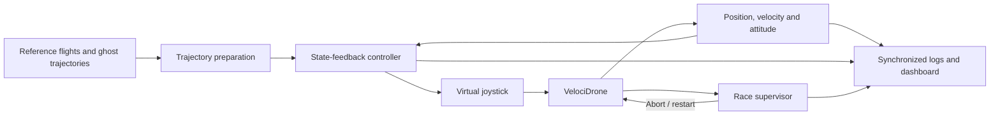

# VelociDrone Racing Lab

**Closed-loop autonomous drone racing — from flight data to verified race results.**

A custom racing system that turns reference trajectories and live simulator state into controller inputs, supervises each attempt, and uses failure analysis to improve the next run.

| Best verified race | Improvement from earlier baseline | Race validation |
|:---:|:---:|:---:|
| **67.873 s · 3 laps** | **51.9% lower total time** | **97 ordered gate events** |

[Watch the demonstration](https://github.com/LeeWonseok-kr/velocidrone-racing-showcase/releases/tag/demo-67.873) · [System architecture](#system-architecture) · [Engineering challenges](#engineering-challenges) · [Verification](#verification)

**[Watch or download the 67.873-second run](https://github.com/LeeWonseok-kr/velocidrone-racing-showcase/releases/download/demo-67.873/demo-67.873s-sticks.mp4)**

Actual simulator footage, synchronized dashboard snapshots, and visible controller stick movements. Playback speed is unchanged. The final still shows the official race result; movement after the finish is outside the timed race.

## The project

The objective is to complete a demanding FPV course autonomously and progressively close the gap to the leaderboard's fastest time.

I built an integrated workflow for controller calibration, reference-flight recording, trajectory preparation, live state-feedback control, race supervision, and post-flight analysis. The same dashboard exposes the control outputs and the evidence needed to assess each attempt.

The strongest result so far comes from a **geometric controller tracking a reference trajectory with live position, velocity, and attitude feedback**. Machine learning models were also trained and evaluated during development; they are a separate experimental branch from the controller demonstrated here.

## System architecture

| Layer | Responsibility |
|---|---|
| **Capture and alignment** | Record controller inputs, simulator state, race events, and screen evidence against a shared host timeline. Capture the start-key event to align launch timing. |
| **Trajectory preparation** | Build a reference path from recorded flight or ghost data, align it with gate progression, and apply local timing and path adjustments. |
| **Feedback control** | Track position and velocity, convert the required motion into attitude and throttle commands, and combine feedback with feedforward through calibrated stick outputs. |
| **Race supervision** | Check state freshness, command validity, race progression, HUD indicators, and abrupt motion changes. Reject invalid commands and manage full race restarts. |
| **Experiment analysis** | Compare successful and failed attempts at corresponding points on the course, retain the evidence, and test targeted changes. |

**Stack:** Python · NumPy · PyTorch experiments · Windows vJoy · WebSocket telemetry · HUD/OCR monitoring · synchronized video and event logging.

## Engineering challenges

### Start alignment and variable spawn positions

The simulator can start a race from one of four positions. Replaying an input sequence with the wrong initial state or timing can produce a different flight.

Recording the start event made launch timing observable. Tracking live state against a reference trajectory made it possible to correct deviations during flight. Consistent success across every spawn position has not yet been established.

### A fast reference contains a path, not the control inputs

The reference replay does not provide the original pilot's stick values. The controller has to generate its own commands from the target path and current flight state.

That requires consistent coordinate frames, trajectory timing, attitude handling, and an input mapping matched to the simulator. Reference speed alone is insufficient when the controlled aircraft cannot follow the same turn with enough clearance.

### Faster flight reduces the margin for error

Increasing the overall pace exposed failures around tight gate sequences. Local timing changes and smooth path adjustments allowed specific sections to be addressed while preserving a successful baseline.

The workflow compares position and attitude errors, control saturation, timing, and visible contact evidence. A faster attempt that misses a gate or damages a propeller remains a failed attempt.

### A finish signal needs supporting evidence

Race completion is checked against ordered gate events, the official result, crash and damage indicators, motion discontinuities, and recorded frames.

Detected collisions trigger a failed attempt and a full restart from the start line. Returning to the previous gate is not treated as a valid recovery for a clean result.

## Verified performance

| Metric | Result |
|---|---|
| Course | 2023 AU NATS 5inch |
| Aircraft | LIGHTSWITCH / DEFAULTQUAD592 |
| Race length | 3 laps |
| Official total time | **67.873 s** |
| Holeshot | 2.584 s |
| Lap times | 22.035 / 21.627 / 21.627 s |
| Earlier verified baseline | 141.063 s |
| Total-time reduction | **73.190 s / 51.9%** |

The reduction describes project progress on the same course across controller and aircraft-setting changes. It is not a controlled comparison of a single algorithm change, a measured increase in top speed, or a claim of first place.

## Verification

The selected run was reviewed using multiple evidence sources:

- **97 ordered gate events** and the official three-lap result.
- **4,048 native telemetry records**, with no candidates detected by the two applied abrupt-deceleration checks.
- **2,858 readable HUD observations** showing zero crashes and zero damage; eight unreadable observations retained as gaps.
- **26 selected source frames** reviewed alongside the official result.
- Integrity and decoding checks covering **4,175 recorded images**, **21,992 events**, and **21,944 stick samples**.

These checks support acceptance of this run. They do not guarantee detection of every contact or establish a repeated success rate. The latest private transfer package also passed **225 host tests**; simulator integration and flight results are evaluated separately.

## Next steps

- Improve clearance and tracking through the remaining high-speed gate sequences.
- Establish repeatability across spawn positions and repeated trials.
- Separate course-specific assumptions so reference replays can support faster adaptation to new maps.
- Evaluate learning-based approaches against the existing feedback-control baseline.

The leaderboard's fastest time remains the target. Vision-only control, generalization to unseen courses, and physical-aircraft deployment have not been demonstrated.

## About this showcase

This repository documents the architecture, engineering decisions, and observed results. **You are welcome to study the approach and build an independent implementation.**

The working source, model weights, raw flight datasets, exact tuning, and executable packages remain private. Detailed tuning information is masked in the demonstration, while stick movements and race status remain visible.

See [NOTICE.md](NOTICE.md) for usage terms. VelociDrone and in-game assets belong to their respective owners. This is an unofficial personal project.
