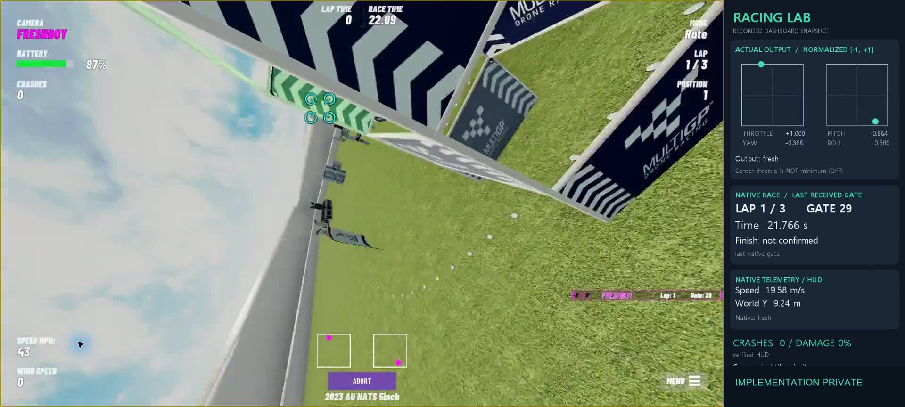

# VelociDrone Racing Lab

VelociDrone에서 드론을 자동 조종하고, 유효 완주를 확인하면서 기록을 줄여가는 개인 프로젝트입니다.

가상 조종기, 캘리브레이션, 비행 기록, 상태 피드백 조종, 실시간 대시보드를 하나의 작업 흐름으로 연결했습니다. 이 저장소에는 시연 영상과 구현 개요만 담았습니다. 실행 가능한 조종 프로그램과 모델은 배포하지 않습니다.

## 시연 영상

**[67.873초 완주 영상 보기·다운로드](https://github.com/LeeWonseok-kr/velocidrone-racing-showcase/releases/download/demo-67.873/demo-67.873s-sticks.mp4)**

실제 시뮬레이터 주행과 동시 기록한 대시보드를 사용했습니다. 재생 속도를 바꾸거나 비행 움직임을 생성하지 않았습니다. 스틱 움직임과 경기 상태는 보이며, 상세 튜닝 정보만 가렸습니다. 마지막 결과 화면은 해당 경기의 공식 기록 화면입니다. 결승 뒤 관성 이동은 경기 구간과 구분합니다.

## 확인한 결과

| 항목 | 결과 |
|---|---|
| 코스 | 2023 AU NATS 5inch |
| 경기 | 3랩 |
| 공식 총 기록 | **67.873초** |
| 홀샷 | 2.584초 |
| 각 랩 | 22.035 / 21.627 / 21.627초 |
| 비교 기준 | 이전 검증 기록 141.063초 → 67.873초 |

게임의 공식 결과, 순서 있는 게이트 통과, 충돌·손상 표시, 원본 상태 로그와 주요 장면을 함께 확인했습니다. 모든 접촉을 검출한다는 보장은 없으며, 설정별 반복 성공률과 다른 코스에서의 성능은 아직 검증하지 않았습니다. 1등 기록 달성이 최종 목표이고, 이 영상은 그 과정의 결과입니다.

## 구현 방식

1. **기록:** 참고 비행과 시뮬레이터 상태를 저장하고 시간 기준을 맞춥니다.
2. **조종:** 목표 주행 경로와 현재 위치·속도·자세의 차이를 바탕으로 가상 조종기 입력을 계산합니다.
3. **검증:** 게이트 진행과 경기 상태를 감시합니다. 충돌하면 해당 시도를 실패 처리하고 출발점에서 다시 시작합니다.
4. **개선:** 완주 여부와 실패 구간을 분석해 주행 경로와 구간별 속도를 조정합니다.

머신러닝 모델의 학습·평가도 실험했지만, **이 영상의 완주는 경로와 상태 피드백을 사용하는 조종기 결과**입니다. 영상만 입력하는 신경망의 완주나 다른 맵에 대한 범용 학습 성공을 주장하지 않습니다. 실제 비행체에는 적용하지 않았습니다.

## 공개 범위

이 저장소는 포트폴리오용입니다. 소스 코드, 모델 가중치, 원본 스틱·상태 데이터, 구체적인 제어식·파라미터, 실행 파일과 재현 절차는 포함하지 않습니다. 별도의 작업 저장소와도 분리되어 있습니다.

자료의 이용 범위는 [NOTICE.md](NOTICE.md)를 확인해 주세요. VelociDrone 및 게임 내 자산의 권리는 각 권리자에게 있습니다. 본 프로젝트는 비공식 개인 프로젝트입니다.
